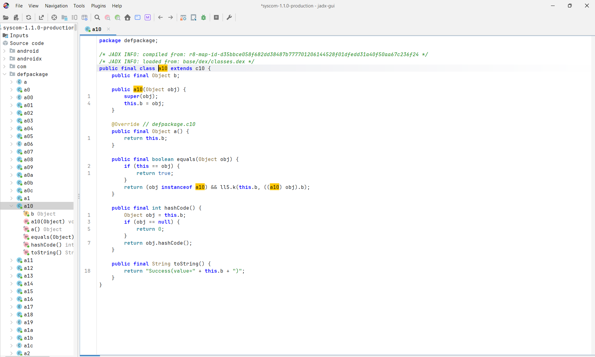

# Ofuscación del build Release con R8

El build Release de Android pasa por **R8**, que reduce el código (quita lo que no se usa) y lo ofusca (renombra clases y métodos), para dificultar la ingeniería inversa del APK.

## Configuración

La app usa Expo, así que `android/` no se versiona: se genera en cada build a partir de [app.config.js](../../app.config.js), con el plugin `expo-build-properties`:

```js
android: {
  enableMinifyInReleaseBuilds: true,  // R8 en el build Release
  extraProguardRules: "-dontwarn com.stripe.android.pushProvisioning.**",  // regla de Stripe (#154)
},
```

Al generar el proyecto Android (`npx expo prebuild`), esa configuración queda así:

| Archivo generado | Contenido |
|---|---|
| `android/gradle.properties` | `android.enableMinifyInReleaseBuilds=true` |
| `android/app/build.gradle` | `minifyEnabled enableMinifyInReleaseBuilds` en `buildTypes.release`, con `proguardFiles getDefaultProguardFile("proguard-android-optimize.txt"), "proguard-rules.pro"` |
| `android/app/proguard-rules.pro` | Reglas de React Native más `-dontwarn com.stripe.android.pushProvisioning.**` |

La plantilla de Expo SDK 58 ya activa R8 por defecto; la opción en `app.config.js` lo deja explícito para no depender de ese valor. La regla de Stripe evita que R8 falle por clases que el proyecto no usa (ver [e2e-apk.md](../pruebas/e2e-apk.md)).

La prueba [appConfigR8.test.ts](../../src/__tests__/appConfigR8.test.ts) falla si se quita R8 o la regla.

## Verificación con JADX

Se descompiló con [JADX](https://github.com/skylot/jadx) 1.5.6 el AAB de producción de la versión 1.1.0 (build de EAS `2a9da230`, commit `5025c49`, 2026-11-10), compilado con R8 activado.



Qué se observa:
- JADX indica `compiled from: r8-map-id-…`: el código pasó por R8.
- R8 sacó las clases de sus paquetes originales y las renombró: JADX las agrupa en `defpackage` con nombres como `a`, `a0`, `a00`, `a10`.
- Dentro de cada clase, campos y métodos también quedan renombrados (`b`, `a()`) y las llamadas apuntan a otras clases ofuscadas (`l15.k(...)`).
- El código de la app (JavaScript) no está en clases Java: va compilado a bytecode de Hermes en `assets/index.android.bundle`.
