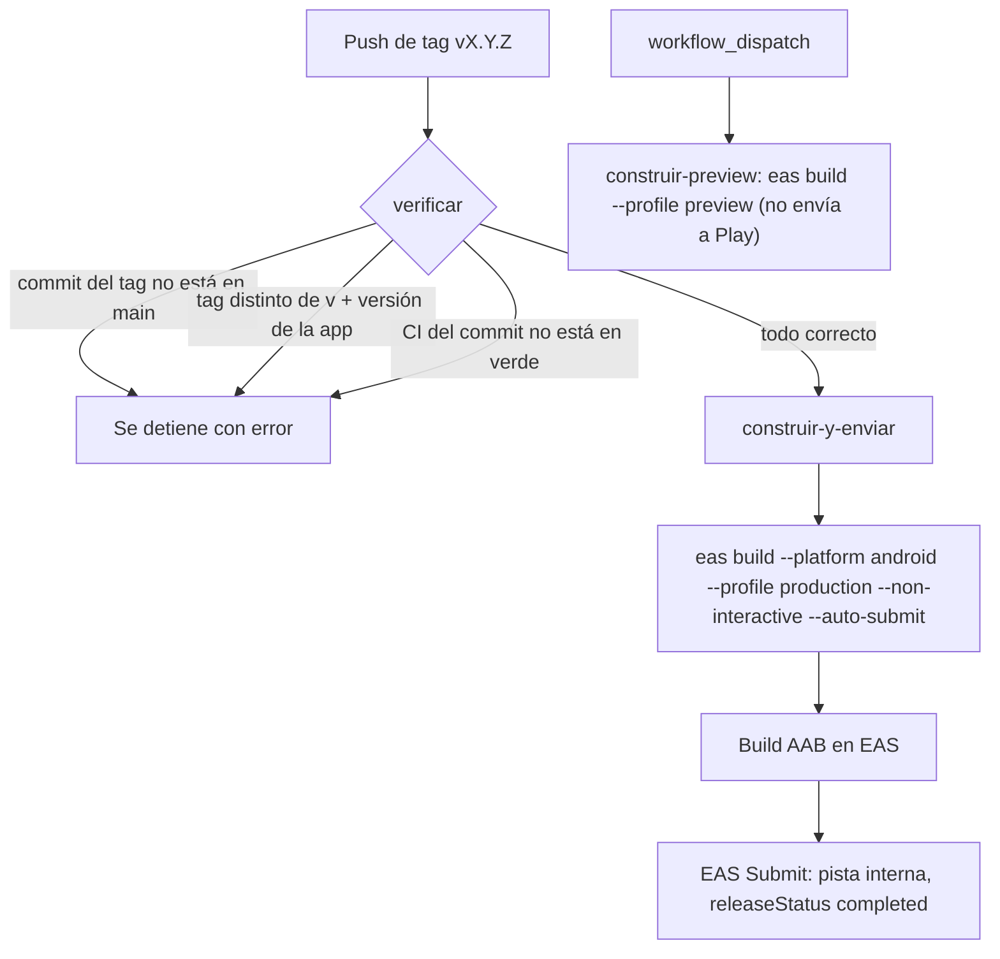

# Entrega continua a Google Play — syscom-mobile

- **Issue:** #221
- **Responsable:** @AngeloMtz. Revisa: @LAHH18.
- **Archivos:** `.github/workflows/entrega-continua.yml`, `scripts/verificar-tag-version.mjs`, `eas.json` (`submit.production.android`).
- **Alcance:** solo CI/CD y documentación. No cambia el código de la app ni su versión.
- Este documento **no contiene valores** de secretos, solo sus nombres. El repositorio es público.

## 1. Qué hace el flujo

Antes el build (`eas build`) y la subida del `.aab` a Google Play eran manuales. Ahora, **al empujar un tag `v*`**, GitHub Actions verifica el release, construye el AAB de producción en EAS y lo envía a la **pista interna** de Google Play.



### Verificaciones del job `verificar` (solo en tags)

| # | Verificación | Cómo |
|---|---|---|
| a | El commit del tag está en `origin/main` | `git merge-base --is-ancestor $GITHUB_SHA origin/main` (checkout con `fetch-depth: 0`) |
| b | El tag es `v` + la versión de la app | `scripts/verificar-tag-version.mjs`: compara con `expo.version` de `app.config.js` y con `version` de `package.json` (deben coincidir entre sí) |
| c | Los checks de CI del commit están en verde | `gh api .../commits/<sha>/check-runs`; exige `Análisis estático` y `Pruebas unitarias` en `success` (cuenta la ejecución más reciente de cada uno) |

Si algo falla, el flujo se detiene con un mensaje en español y **no se construye ni se envía nada**.

### Seguridad

- `permissions`: solo `contents: read` y `checks: read`.
- `concurrency` por ref (sin cancelar ejecuciones en curso) y `timeout-minutes` en cada job.
- Actions con versión fija: `actions/checkout@v7.0.1`, `actions/setup-node@v7.1.0`, `expo/expo-github-action@9.0.2` (los tags de esta última no llevan prefijo `v`).
- `EXPO_TOKEN` es un secreto de GitHub (robot de Expo con rol Developer). Se pasa solo como `token` de `expo-github-action`; nunca se imprime. `eas whoami` solo muestra el usuario.
- La llave de Google (cuenta de servicio `eas-submit@syscom-play-publisher`) está guardada en EAS, no en el repositorio, y tiene permiso **solo** de "Lanzar aplicaciones en canales de pruebas": aunque se filtrara, no puede publicar en producción.

## 2. Cómo hacer un release

1. Crear `release/x.y.z` desde `develop` y subir la versión (`app.config.js` `expo.version` y `package.json` `version`, la misma en ambos).
2. Abrir un PR de `release/x.y.z` hacia `main`; esperar CI en verde y la aprobación de la otra persona del equipo. Fusionar.
3. Crear el tag **sobre el commit fusionado en `main`** y empujarlo:
   ```bash
   git checkout main && git pull
   git tag vX.Y.Z
   git push origin vX.Y.Z
   ```
4. Seguir el flujo en la pestaña *Actions* ("Entrega continua"). Al terminar, la versión aparece en la pista interna de Play Console.
5. Borrar la rama `release/x.y.z`.

Para solo probar un build sin enviar: *Actions → Entrega continua → Run workflow* (construye el perfil `preview`, un APK interno).

## 3. Si falla

| Dónde falla | Causa probable | Qué hacer |
|---|---|---|
| `verificar`: tag fuera de main | Se etiquetó antes de fusionar | Borrar el tag (`git push origin :refs/tags/vX.Y.Z`), fusionar y re-etiquetar |
| `verificar`: tag ≠ versión | Se olvidó subir la versión o el tag tiene otro formato | Corregir la versión por PR, o borrar y recrear el tag correcto |
| `verificar`: CI no está en verde | Un check falló, o aún no termina | Corregir, o esperar a que termine, y usar *Re-run jobs* |
| `construir-y-enviar`: autenticación (`eas whoami`) | `EXPO_TOKEN` ausente, revocado o vencido | Crear un token nuevo y actualizar el secreto (sección 4) |
| Build falla | Error de compilación o de credenciales en EAS | Revisar el enlace del build en el log y los registros en expo.dev |
| Submit falla | Llave de Google sin asignar o sin permiso; `versionCode` ya subido | Revisar *Submissions* en expo.dev. Con `--non-interactive`, EAS usa la llave asignada a la app; si no hay, falla |

Si el build ya se creó pero el envío falló, se puede reintentar a mano (`eas submit --platform android --profile production --latest`) o subir el `.aab` en Play Console.

## 4. Revocar credenciales

- **`EXPO_TOKEN`:** expo.dev → *Access tokens* → revocar el token del robot. Crear uno nuevo y actualizar el secreto en GitHub: *Settings → Secrets and variables → Actions → `EXPO_TOKEN`*.
- **Llave de la cuenta de servicio de Google:** Google Cloud Console → *IAM y administración → Cuentas de servicio* → `eas-submit@syscom-play-publisher` → *Claves* → eliminar la clave. Para quitar el acceso por completo, quitar al usuario en Play Console → *Usuarios y permisos*. Crear una clave nueva y volver a cargarla en EAS (`eas credentials --platform android` o expo.dev → Credentials → Service credentials).
- Si hay sospecha de uso indebido, revocar ambas y revisar *Actions* y *Submissions*.

## 5. Límites

- **Solo sube a la pista interna** (`track: "internal"`); la cuenta de servicio no tiene permiso para otras pistas.
- La promoción a prueba cerrada o producción es **manual** en Play Console, tras revisar la pista interna.
- `releaseStatus: "completed"` publica de inmediato en la pista interna. Si la ficha de la app sigue incompleta, Google puede exigir otro estado; en ese caso usar `draft` y completar el lanzamiento en la consola (así lo indica la doc de Expo).
- No sube versión ni cambia código: la versión debe estar ya fusionada en `main` antes del tag.
- `--auto-submit` espera a que termine el build (no se usa `--no-wait`; la doc no confirma que funcionen juntos), así que el job puede durar bastante y consume una compilación de EAS.
- El flujo completo en GitHub y el filtro de checks con `jq` **no se han probado todavía** (ver sección 6).

## 6. Validación manual pendiente (Angel)

**PENDIENTE DE VALIDACIÓN MANUAL.** No se ejecutó `eas build`, `eas submit` ni el workflow.

1. Fusionar el PR de #221 a `develop` (aprobado por Luis Ángel) y llevarlo a `main` en el siguiente release.
2. Confirmar que existe el secreto `EXPO_TOKEN` y que la llave está asignada: `eas credentials --platform android` (o expo.dev → Credentials).
3. Prueba sin enviar: *Actions → Entrega continua → Run workflow* (perfil `preview`). Debe pasar `eas whoami` y construir.
4. Prueba de las verificaciones: empujar un tag con versión equivocada (p. ej. `v9.9.9`) y comprobar que `verificar` falla con mensaje claro y no construye. Borrar el tag después.
5. Primer envío real: en el próximo release, empujar el tag correcto y confirmar en Play Console (pista interna) que aparece la versión. Si falla por el estado de la ficha, probar `releaseStatus: "draft"`.
